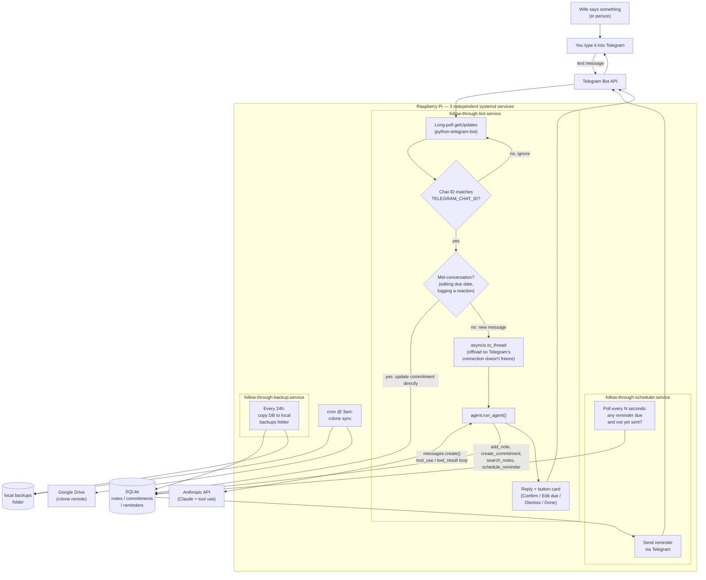

# Follow Through

A personal agent that helps me catch the small things my wife mentions, turn the actionable ones into committed acts, and make sure I actually follow through — without her having to remind me.

Her top love language is Acts of Service, and the research on it is specific about the single biggest way partners fail at it: lacking follow-through on tasks big and small. This project exists to make sure that failure mode doesn't happen on my watch.

**Status:** implemented and deployed — running live on a Raspberry Pi 3.

## How it works

A Telegram bot captures messy free-text notes, classifies each item (`ask` / `preference` / `context`), proposes a concrete act and due date for anything actionable, nudges once at the due date, and asks for a one-line reaction when something's done.

Full design: [`docs/superpowers/specs/2026-10-30-follow-through-agent-design.md`](docs/superpowers/specs/2026-10-30-follow-through-agent-design.md)

Each revision gets its own dated file in `docs/superpowers/specs/`, so the design history is preserved as this evolves.

### Architecture



A few things worth knowing about this picture:

- **The bot itself never "thinks."** It's a thin adapter: receive message → check it's really you → hand the text to `agent.run_agent()` → send back whatever Claude decided to do. All the judgment (is this actionable? what's the first concrete step? when should the reminder fire?) happens inside the Claude tool-use loop, not in `bot.py`.
- **`asyncio.to_thread` matters.** Without it, the (blocking) call out to Claude's API would freeze the bot's connection to Telegram itself — this was a real bug caught deploying to a Raspberry Pi 3, where the API round trip was slow enough to time out Telegram's own long-poll connection.
- **Three separate systemd services, one shared SQLite file.** The bot writes new notes/commitments; the scheduler only reads reminders and marks them sent; the backup service only reads the whole DB to copy it. None of them talk to each other directly — the database is the shared state.
- **Backups are two hops, not one.** The app only ever writes to a local folder on the SD card; `rclone` (via cron, outside the app entirely) is what actually gets a copy off the Pi and into Google Drive.

### Telegram integration

The app doesn't expose anything to the internet — it reaches out to Telegram, nothing reaches in. That's what makes it deployable on a home network with no port forwarding, no public IP, and no TLS certificate to manage.

- **Identity:** [@BotFather](https://t.me/botfather) (Telegram's own bot for creating bots) issues a bot token when you register a new bot. That token is what lets `follow_through/bot.py` authenticate to Telegram's Bot API as that specific bot — it's the only thing Telegram actually checks.
- **Transport — long polling, not webhooks:** `build_app()` calls `app.run_polling()` (via `python-telegram-bot`), which repeatedly asks Telegram's servers "any new messages for me?" over an outbound HTTPS connection. The alternative — webhooks — would require Telegram to be able to reach an HTTPS endpoint *on the Pi*, which a home router normally blocks. Polling flips that: the Pi always initiates the connection, so it works from behind NAT with zero network configuration.
- **Privacy despite being a "public" bot:** Telegram usernames are searchable — anyone who types the bot's exact username into Telegram's search (the same way you'd find `@BotFather`) could open a chat with it and send it a message. That gets them nothing: every handler in `bot.py` (`handle_message`, `handle_open`, `handle_week`, `handle_button`) starts with `_is_authorized_chat()`, which checks the sender's chat ID against `TELEGRAM_CHAT_ID` in `.env` and returns immediately on a mismatch — no reply, no database read, no database write, nothing logged about what they sent. That one environment variable is the entire access-control model, and it fully neutralizes the bot being technically findable.

  The thing actually worth protecting is the **bot token** itself, not the username. Whoever holds the token can call Telegram's API *as* that bot — including reading incoming messages via `getUpdates` before the real app consumes them. Treat it like any other secret in `.env`: never paste it into a chat, a commit, or a log; if it's ever exposed, revoke and reissue it via `@BotFather` (`/mybots` → your bot → API Token → Revoke current token).
- **Commands vs. free text:** `/open`, `/week` and `/help` are registered as explicit `CommandHandler`s (the list lives in `bot.BOT_COMMANDS`, which also populates Telegram's "/" menu at startup); everything else (the actual notes about your wife) flows through a single `MessageHandler` into `agent.run_agent()`. Button taps (Confirm/Edit due/Dismiss/Done) come back as a separate `CallbackQueryHandler`, not as text messages.

Full setup steps (BotFather walkthrough, finding your chat ID) are in [`deploy/README.md`](deploy/README.md#6-configure-secrets).

## Running it

```bash
uv sync
cp .env.example .env   # fill in your own secrets
uv run pytest          # 61 tests
```

For a full from-scratch deployment (flashing a Raspberry Pi, Telegram bot setup, cloud backups, systemd services, troubleshooting), see [`deploy/README.md`](deploy/README.md).

## License

MIT — see [LICENSE](LICENSE).
